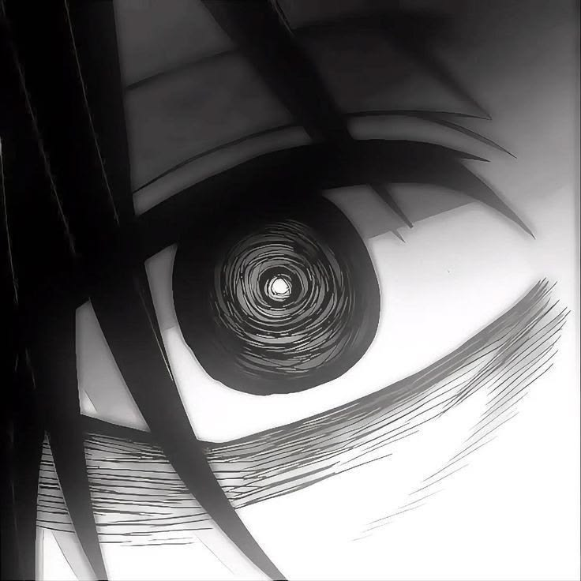

<!-- ═════════════════ PORTADA ═════════════════ -->
<p align="center">
  
</p>

<p align="center">
  <a href="https://github.com/LuisVanegas2">
    
  </a>
</p>

<p align="center">
  
  
</p>

<p align="center"></p>

<!-- ═════════════════ SOBRE MÍ ═════════════════ -->
<table>
<tr>
<td width="38%" align="center">
  
  <br/>
  <sub><b>「 目覚めろ 」</b></sub>
</td>
<td width="62%">

### ▌ 第一話 — Sobre mí

Soy **Luis Alfredo Vanegas Ávila**, estudiante de redes y desarrollo. Me gusta seguir el recorrido de un paquete de router en router y medir cuánto tiempo le gana una GPU a una CPU. También me gustan los videojuegos y programar en Unity.

```yaml
personaje:  Luis Vanegas
clase:      Redes + Desarrollo
poderes:    [Python, C, C#, CUDA, Unity, Streamlit]
redes:      [Cisco IOS, Packet Tracer, RIP, Rutas estáticas]
estado:     ██████████░░░░  entrenando...
```

</td>
</tr>
</table>

<p align="center"></p>

<!-- ═════════════════ PROYECTOS ═════════════════ -->
## ▌ 第二話 — En mi laboratorio

<table>
<tr>
<td width="50%" valign="top">

### 🎧 GuauMiau
¿Qué animal se escucha en una grabación? GuauMiau toma un clip de audio, identifica el sonido y permite comparar los tiempos de inferencia en **CPU vs GPU**.

`Python` · `CUDA` · `AST` · `Streamlit`

[**Explorar GuauMiau →**](https://github.com/gminos/GuauMiau)

</td>
<td width="50%" valign="top">

### 🌐 Prácticas de redes
En Cisco Packet Tracer conecto routers 1841 por enlaces seriales y pruebo dos maneras de llegar al destino: **rutas estáticas** o dejando que los routers intercambien rutas con **RIP**.

`Cisco IOS` · `Packet Tracer`

</td>
</tr>
</table>

<p align="center"></p>

<!-- ═════════════════ ARSENAL ═════════════════ -->
## ▌ 第三話 — Arsenal

<p align="center">
  
</p>

<p align="center">
  
  
  
  
</p>

<p align="center"></p>

<!-- ═════════════════ ESTADÍSTICAS ═════════════════ -->
## ▌ 第四話 — Poder de combate

<p align="center">
  
  
</p>

<p align="center">
  
</p>

<p align="center">
  
</p>

<p align="center">
  
</p>

<p align="center"></p>

<!-- ═════════════════ SERPIENTE ═════════════════ -->
## ▌ 第五話 — Rastro de batalla

<p align="center">
  <picture>
    <source media="(prefers-color-scheme: dark)" srcset="https://raw.githubusercontent.com/LuisVanegas2/LuisVanegas2/output/snake-dark.svg" />
    
  </picture>
</p>

<details>
<summary>🖥️ Abrir mi terminal</summary>
<br/>
<p align="center"></p>

```text
LuisVanegas2@github
Lenguajes    Python · C · C#
Desarrollo   CUDA · Unity · Streamlit
Redes        Cisco IOS · Packet Tracer
```

</details>

<p align="center">
  
</p>
